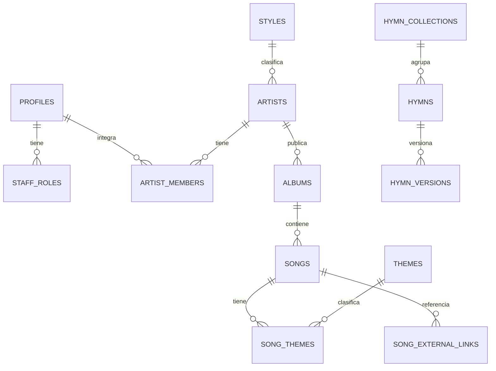

# Modelo de datos v2

> **Estado:** alcance funcional acordado. El núcleo (identidad, catálogo e
> himnario versionado) ya tiene migraciones en `database/migrations/` y seed de
> desarrollo. La estrategia es incremental:
> primero identidad, catálogo e himnario; los demás módulos agregan tablas en sus
> fases, sin redefinir el núcleo.
>
> PostgreSQL es la fuente de verdad estructurada. Los archivos binarios viven en
> almacenamiento S3-compatible, excepto los PDFs personales del músico, que solo
> permanecen en su dispositivo.

## 1. Decisiones acordadas

1. Himnos y canciones comerciales son dominios separados. Cada himno puede tener
   varias versiones de contenido, inicialmente `full_song` y `verse_chorus`.
2. `artists` representa a Trío Misión, el coro polifónico y futuros grupos, sin
   tablas específicas por artista.
3. `songs` contiene la obra editorial en ChordPro; `tracks` representa una
   grabación y `media_assets` sus archivos. Una canción puede no tener audio y
   una grabación puede no estar vinculada a una canción del catálogo.
4. Premium es una suscripción temporal para los beneficios publicados. No incluye
   automáticamente audio descargable ni permisos de grabación/publicación.
5. El audio se vende por álbum, catálogo o pista habilitada. Los permisos de uso
   son complementos independientes, configurados por artista y sobrescritos por
   pista cuando exista autorización suficiente.
6. Una compra congela producto, precio, contenido y términos aplicables en sus
   líneas. Cambios posteriores del catálogo no reescriben el historial.
7. Órdenes, intentos de pago, suscripciones, entitlements y licencias son conceptos
   distintos. Solo el backend concede acceso, de forma idempotente.
8. El procesamiento de audio es asíncrono y crea activos nuevos; nunca sobrescribe
   el master ni publica derivados sin revisión.
9. Un solo PostgreSQL lógico es suficiente. Separar bases solo ante una necesidad
   operativa demostrada.
10. Los PDFs personales no se suben ni sincronizan, tampoco con Premium.

## 2. Núcleo para las primeras migraciones

### 2.1 Diagrama ER



### 2.2 Identidad y autorización

```text
profiles
  id                  uuid PK, FK lógica a auth.users(id)
  display_name        text
  avatar_key          text NULL
  is_banned           boolean NOT NULL DEFAULT false
  ban_reason          text NULL
  created_at          timestamptz NOT NULL
  updated_at          timestamptz NOT NULL

staff_roles
  user_id             uuid FK profiles
  role                text NOT NULL  -- admin | editor | vendedor
  created_at          timestamptz NOT NULL
  PRIMARY KEY (user_id, role)

artist_members
  artist_id           uuid FK artists
  user_id             uuid FK profiles
  member_role         text NOT NULL  -- member | manager
  created_at          timestamptz NOT NULL
  PRIMARY KEY (artist_id, user_id)
```

GoTrue conserva credenciales y sesiones. La API decide la autorización consultando
estas tablas; los roles no dependen de claims ni de excepciones en los clientes.
`member` puede entrar al sistema administrativo, pero solo lee canciones/contenido
autorizado de sus artistas: no edita, no revisa pagos ni administra. `manager`
administra únicamente sus artistas. Ninguno recibe alcance global ni acceso comercial
implícito; esos permisos se validan explícitamente por `artist_id`.

### 2.3 Catálogo

```text
styles
  id                  smallint PK
  slug                text UNIQUE NOT NULL
  name                text UNIQUE NOT NULL
  sort_order          smallint NOT NULL

artists
  id                  uuid PK
  slug                text UNIQUE NOT NULL
  name                text NOT NULL
  style_id            smallint NULL FK styles
  country             text NULL
  bio                 text NULL
  cover_key           text NULL
  social_links        jsonb NOT NULL DEFAULT '{}'
  is_published        boolean NOT NULL DEFAULT false
  created_at          timestamptz NOT NULL
  updated_at          timestamptz NOT NULL
  deleted_at          timestamptz NULL

albums
  id                  uuid PK
  artist_id           uuid NOT NULL FK artists
  title               text NOT NULL
  year                smallint NULL
  cover_key           text NULL
  sort_order          smallint NOT NULL
  is_published        boolean NOT NULL DEFAULT false
  created_at          timestamptz NOT NULL
  updated_at          timestamptz NOT NULL
  deleted_at          timestamptz NULL

songs
  id                  uuid PK
  album_id            uuid NOT NULL FK albums
  title               text NOT NULL
  chordpro            text NOT NULL
  original_key        text NULL
  capo                smallint NULL
  bpm                 smallint NULL
  author              text NULL
  arranger            text NULL
  publication_access  text NOT NULL  -- free | premium | purchase | creator
  tab_pdf_key         text NULL
  sort_order          smallint NOT NULL
  is_published        boolean NOT NULL DEFAULT false
  created_at          timestamptz NOT NULL
  updated_at          timestamptz NOT NULL
  deleted_at          timestamptz NULL

themes
  id                  smallint PK
  slug                text UNIQUE NOT NULL
  name                text UNIQUE NOT NULL

song_themes
  song_id             uuid FK songs
  theme_id            smallint FK themes
  PRIMARY KEY (song_id, theme_id)

song_external_links
  id                  uuid PK
  song_id             uuid NOT NULL FK songs
  provider            text NOT NULL  -- spotify | youtube
  external_id         text NULL
  canonical_url       text NOT NULL
  verified_at         timestamptz NULL
  availability_status text NOT NULL  -- unknown | available | unavailable
  created_at          timestamptz NOT NULL
  updated_at          timestamptz NOT NULL
  UNIQUE (song_id, provider)
```

`publication_access` sustituye a `is_free` y expresa la política editorial actual;
no prueba titularidad ni autoriza contenido. Un enlace externo solo abre el
proveedor correspondiente: no equivale a alojar audio ni autoriza transcripciones.

### 2.4 Himnario versionado

```text
hymn_collections
  id                  uuid PK
  slug                text UNIQUE NOT NULL
  name                text NOT NULL
  edition_label       text NULL
  language_code       text NOT NULL
  created_at          timestamptz NOT NULL

hymns
  id                  uuid PK
  collection_id       uuid NOT NULL FK hymn_collections
  hymn_number         integer NOT NULL
  title               text NOT NULL
  created_at          timestamptz NOT NULL
  updated_at          timestamptz NOT NULL
  deleted_at          timestamptz NULL
  UNIQUE (collection_id, hymn_number)

hymn_versions
  id                  uuid PK
  hymn_id             uuid NOT NULL FK hymns
  version_code        text NOT NULL  -- chords_full | verse_chorus
  chord_scope         text NOT NULL  -- full_song | verse_chorus | lyrics_only
  arrangement_label   text NULL
  content_format      text NOT NULL  -- chordpro
  chordpro            text NOT NULL
  original_key        text NULL
  capo                smallint NULL
  source_revision     text NULL
  is_published        boolean NOT NULL DEFAULT false
  created_at          timestamptz NOT NULL
  updated_at          timestamptz NOT NULL
  deleted_at          timestamptz NULL
  UNIQUE (hymn_id, version_code)
```

El número y título pertenecen al himno, no se repiten en cada versión. El himnario
será gratuito cuando se confirmen los permisos de distribución; su publicación no
debe inferirse de que otras aplicaciones ofrezcan contenido similar.

## 3. Grabaciones, media y derechos

Estas entidades se agregan al implementar la tienda de audio:

```text
compositions
  id, title, status, created_at, updated_at

tracks
  id, artist_id FK, song_id NULL FK, composition_id NULL FK,
  title, description, track_type, is_published,
  created_at, updated_at, deleted_at

media_assets
  id, storage_key UNIQUE, media_type, mime_type, byte_size,
  checksum_sha256, duration_ms, codec, sample_rate, channels,
  visibility, processing_status, created_at, deleted_at

track_media
  track_id FK, media_asset_id FK, role,
  is_published, created_at,
  PRIMARY KEY (track_id, media_asset_id, role)

media_jobs
  id, job_type, parameters_json, tool_version, status, progress,
  error_code, created_at, started_at, completed_at

media_job_assets
  media_job_id FK, media_asset_id FK, input_output_role,
  PRIMARY KEY (media_job_id, media_asset_id, input_output_role)
```

`composition_id` es nullable hasta disponer de información fiable; no se infiere
la titularidad de la composición o grabación a partir del artista del catálogo.
Las partes y autorizaciones de derechos se registran explícitamente cuando ese
módulo se implemente.

Los roles de media incluyen `master`, `preview`, `instrumental`, `vocal`,
`accompaniment`, `stem` y `practice_mix`. Los masters son inmutables; una corrección
crea otro asset y cambia la relación publicada tras revisión.

### Permisos de uso

```text
artist_license_profiles
  artist_id PK/FK, default_permissions jsonb, updated_at

track_license_options
  id, track_id FK, use_code, add_on_amount_minor, currency,
  enabled, created_at, updated_at,
  UNIQUE (track_id, use_code)

license_terms_versions
  id, artist_id FK, version_label, terms_text, published_at, created_at

license_acceptances
  id, order_id FK, terms_version_id FK, user_id FK, accepted_at,
  UNIQUE (order_id, terms_version_id)

license_grants
  id, user_id FK, track_id FK, order_item_id NULL FK,
  license_option_id NULL FK, terms_version_id NULL FK,
  accepted_uses jsonb, granted_at, revoked_at,
  UNIQUE parcial por order_item_id
```

Implementado en migraciones `00021_licencias_config.sql` y `00022_license_grants.sql`
(Sprint 3C.2). La oferta efectiva se configura por pista (`track_license_options`):
una pista es elegible cuando está publicada y tiene al menos una opción habilitada.
Los usos previstos son práctica, interpretación en iglesia/concierto, grabación vocal,
publicación y monetización. Descarga/escucha pertenece al audio base.
Términos inmutables y versionados (append-only); el comprador acepta los términos
vigentes al crear la orden (`license_acceptances`). Las licencias se adquieren como
complementos del audio en la misma orden, congelando `license_snapshot` en
`order_items`. Al aprobarse el pago, se emite el `license_grant` de forma
transaccional e idempotente. Descargar audio jamás concede licencias; Premium tampoco;
y las licencias nunca otorgan el archivo master de audio. La revocación staff
(`revoked_at` y auditoría) es independiente del acceso al audio.

## 4. Productos, ofertas, órdenes y acceso

```text
products
  id, artist_id NULL FK, product_type (track|album|catalog|premium),
  title, description,
  plan_id NULL FK plans,         -- solo product_type = 'premium'
  include_future_tracks boolean, -- paquetes: false = solo snapshot congelado
  active, created_at, updated_at

product_items
  product_id FK, track_id NULL FK, media_asset_id NULL FK,
  sort_order,
  CHECK (exactamente una referencia de contenido)

offers
  id, product_id FK, amount_minor, currency, sales_channel,
  starts_at, ends_at, active

orders
  id, user_id FK, status, subtotal_minor, discount_minor, total_minor,
  currency, coupon_id NULL FK coupons, coupon_code NULL,
  idempotency_key, created_at, expires_at, paid_at,
  CHECK (total = subtotal - discount) CHECK (total > 0)

order_items
  id, order_id FK, product_id NULL FK, offer_id NULL FK,
  track_id NULL FK, product_snapshot jsonb, content_snapshot jsonb,
  license_snapshot jsonb NULL, quantity, unit_amount_minor,
  line_total_minor

coupons
  id, code UNIQUE, description, discount_type (percent|fixed),
  percent_off NULL, amount_minor NULL, currency NULL,
  min_subtotal_minor, max_uses_total NULL, max_uses_per_user,
  used_count, starts_at, ends_at, active,
  CHECK (exactamente una forma de descuento)

coupon_uses
  coupon_id FK, user_id FK, order_id FK, discount_minor, created_at,
  PK (coupon_id, user_id, order_id)

payment_attempts
  id, order_id FK, provider, status, amount_minor, currency,
  provider_transaction_id NULL, provider_status NULL,
  idempotency_key, raw_payload jsonb NULL,
  created_at, confirmed_at

payment_evidence
  id, payment_attempt_id FK, private_storage_key,
  reviewed_by NULL FK profiles, review_status, review_comment,
  created_at, reviewed_at

plans
  id, code UNIQUE, name, description, duration_days, benefits jsonb,
  active, created_at, updated_at

subscriptions
  id, user_id FK, plan_id FK, order_item_id NULL FK,
  redemption_id NULL FK redemptions, status (active|revoked|cancelled),
  grant_source (purchase|redemption|gift|manual),
  period_start, period_end, revoked_at, revoked_reason, created_at,
  UNIQUE parcial por order_item_id y por redemption_id

redemption_codes
  id, code UNIQUE, description, grant_type (premium|package),
  plan_id NULL FK, product_id NULL FK, max_uses, used_count,
  starts_at, ends_at, active,
  CHECK (exactamente un beneficio: plan o producto)

redemptions
  id, code_id FK, user_id FK, idempotency_key,
  content_snapshot jsonb, created_at,
  UNIQUE (code_id, user_id), UNIQUE (user_id, idempotency_key)

entitlements
  id, user_id FK, order_item_id NULL FK, redemption_id NULL FK,
  track_id NULL FK, media_asset_id NULL FK,
  grant_source, granted_at, valid_until, revoked_at,
  CHECK (exactamente un objetivo)
```

`product_items` define el contenido vigente del paquete. `order_items` guarda los
snapshots de la compra, incluidos archivos, usos y términos. El producto indica
si un paquete de catálogo incluye futuras incorporaciones
(`include_future_tracks`): cuando es `false` solo se entregan las pistas
congeladas en el snapshot de la orden; cuando es `true`, la aprobación entrega
el contenido publicado vigente del producto.

Las órdenes conservan subtotal, descuento y total calculados por el backend; el
cliente solo envía el código del cupón y jamás decide el descuento. Los cupones
son porcentuales (1-99%) o fijos (monto y moneda), con vigencia, monto mínimo y
límites total/por usuario; un cupón que dejaría el total en cero se rechaza y
ninguna orden persiste total cero o negativo.

Los entitlements de audio apuntan a una pista o asset concreto mediante columnas
con FK y un `CHECK`, no a una referencia polimórfica sin integridad. Los accesos
promocionales usan la misma vía con `grant_source=gift|creator_promo|redemption`;
Premium se calcula desde períodos de suscripción (`subscriptions`), no desde un
booleano permanente: `premium_activo` = existe suscripción `active` con
`period_end > now()`. Los códigos de canje conceden suscripción o entitlements
con `grant_source=redemption` sin crear pago, con vigencia, límites,
idempotencia por (código, usuario) y por clave de cliente, y trazabilidad
(`subscriptions.redemption_id`, `entitlements.redemption_id`); el contenido
concedido se congela en `redemptions.content_snapshot`. Una suscripción nueva
extiende el período vigente del usuario cuando existe.

## 5. Servicios, biblioteca y soporte

La composición/producción por encargo sigue `service_requests` → `service_quotes`
→ `service_projects` → `service_deliverables`; no es checkout de descarga inmediata.

La biblioteca remota usa `user_song_folders`, `user_songs`, `setlists` y
`setlist_items`. Cada posición de setlist tendrá FKs nullable independientes a
`song_id`, `hymn_version_id` y `user_song_id`, con un `CHECK` que exija exactamente
una. Favoritos se implementará con tablas/relaciones concretas por tipo de recurso;
no se usará `resource_type/resource_id` sin FK.

La sincronización y las descargas offline agregan `devices`, `offline_downloads`
y `push_tokens`. Los dispositivos **no** forman parte de `profiles`: un usuario
puede tener varios, se registran y dan de baja con el sync, y son la unidad a la
que se atan las licencias de descarga y los tokens push. La tabla `devices` se
adelantó en el Sprint 3B (migración 00015) para el registro de instalaciones por
API —alta/refresco, heartbeat y revocación, sin tokens de sesión ni secretos—:

```sql
devices
  id              uuid PK
  user_id         uuid FK profiles   -- un usuario, varios dispositivos
  install_id      text               -- identificador estable de instalación (cliente)
  platform        text               -- android | ios | windows | macos | linux | web
  app_version     text
  device_name     text
  first_seen_at   timestamptz
  last_seen_at    timestamptz        -- último heartbeat
  revoked_at      timestamptz        -- revocación propia o staff (definitiva)
  revoked_reason  text
  UNIQUE (user_id, install_id)
```

Las licencias offline (`offline_downloads`) y los tokens push (`push_tokens`)
se agregan en Fase 4 referenciando `devices.id`.

Soporte y operación agregan `notifications`, `support_tickets`,
`support_messages`, `audit_events`, `app_config` y `telemetry_events`. Tickets y
auditoría pueden relacionarse con órdenes, pagos, descargas y licencias; los
comprobantes y adjuntos privados nunca van a logs.

## 6. Reglas transversales

- UUID para contenido, identidades comerciales y recursos; `smallint` para dominios
  pequeños y estables. UUID v7 si la versión de PostgreSQL/extensiones lo permite.
- `created_at` en registros persistentes; `updated_at` y `deleted_at` en recursos
  sincronizados. Pagos y auditoría conservan historial, sin borrado financiero.
- Índices para FKs, lecturas publicadas y sync por `updated_at`; índices parciales
  `WHERE deleted_at IS NULL` cuando aporten a las consultas reales.
- Importes en unidades menores enteras y moneda ISO, nunca `float`.
- Checks de base para catálogos cerrados de estados y `CHECK` de referencias
  exclusivas. La API además valida las transiciones de negocio.
- Autorización exclusivamente en API; sin RLS/PostgREST ni RPCs de negocio heredados.
- Los archivos privados se entregan con URLs firmadas breves tras verificar acceso.
- Los PDFs personales permanecen locales. Exportación/backup manual puede ofrecerse
  sin convertirlo en sincronización de servidor.

## 7. Escalabilidad

El catálogo y el himnario tienen volúmenes pequeños para PostgreSQL. El costo real
crece en almacenamiento, transferencia y procesamiento de audio, no en las tablas.
La prioridad de escala es separar S3 y workers, medir y después considerar caché,
réplicas o particionamiento solo si hacen falta. No se creará una base musical
independiente por anticipación.

## 8. Orden de entrega

1. Migraciones del núcleo: perfiles, roles, catálogo, enlaces e himnario versionado.
2. Seed del himnario y módulos `catalog`/`himnario` de lectura.
3. Productos, ofertas, órdenes, pago manual auditado, suscripciones y entitlements.
4. Tracks, media privada, previews, descargas y licencias autorizadas.
5. Servicios de composición, soporte y procesamiento asíncrono de audio.
6. Dispositivos (`devices`, adelantada en 3B para el registro por API),
   descargas offline y notificaciones push.
7. Alineaciones letra/audio cuando se concrete su granularidad; el autoscroll actual
   del cliente no requiere tablas nuevas.
